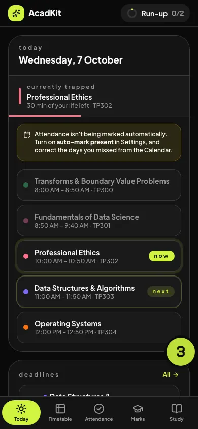
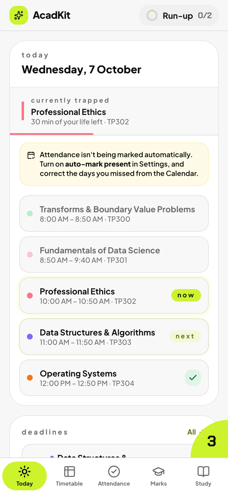
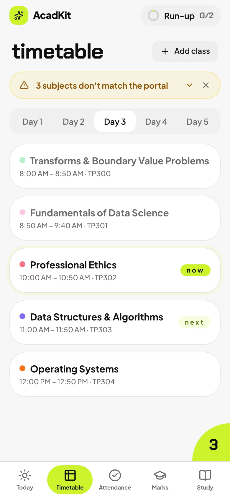
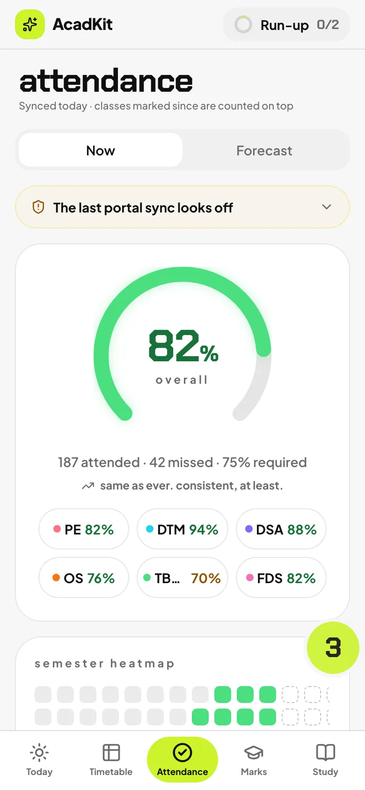
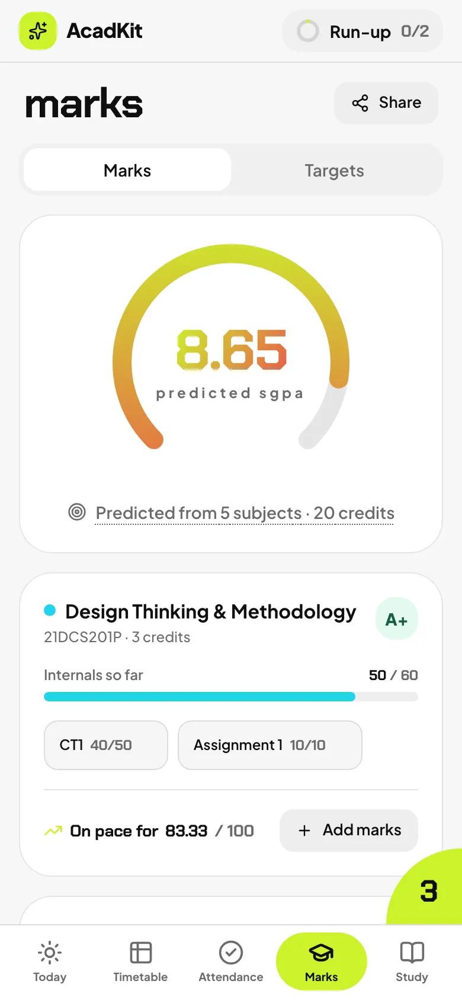
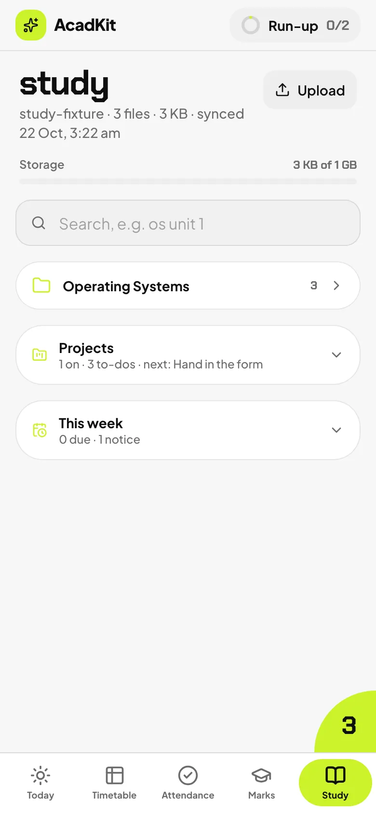

# AcadKit

[](https://github.com/KunalShukla-Al/Acadkit/actions/workflows/ci.yml)
[](LICENSE)

My academic app for SRM KTR: attendance, marks and SGPA, the Day Order timetable, deadlines and my
study files, on my phone and my Mac. It's a PWA that syncs across devices, and my Mac does the
heavy work: it mirrors my study folder, reads notices and past papers with a local model,
transcribes lectures and links them all together.

<p align="center"></p>

## Five tabs

<p align="center">
  
  
  
  
  
</p>

- **Today**: the day's classes, the one on now and the one next, then what's due. Above them
  only what needs me: a suggestion, a page to continue, an undo.
- **Timetable**: the classes of each Day Order, on SRM's 5-day rotation.
- **Attendance**: how many classes each subject can spare, what it takes to get back above the
  bar, a forecast, and a heatmap of the semester.
- **Marks**: the predicted SGPA, each subject's internals, and what each remaining test needs for
  the grade I want.
- **Study**: my notes folder from the Mac, with search inside files and lectures, a viewer for
  PDF, Word, PowerPoint, spreadsheets and code, and on each page what links to it: a moment in
  class, a past paper's question, another set of notes ([how a link is chosen](docs/connected.md)).

The **Run-up**, a day-by-day plan to the end-sems, is a chip in the top bar that counts the day's
targets. The **corner**, a lime quarter-disc above the tab bar showing today's Day Order, opens the rest:
the calendar, the days I can skip, flashcards, past semesters and settings.

Tap a number (classes to spare, marks needed, the predicted SGPA) and it plays how it was worked
out, step by step, with captions and an optional voice; it saves as a video
([how](docs/show-your-work.md)).

## On the Mac

- **The sync** mirrors my study folder within seconds of a change, and the menu bar shows the day
  and how each job went. A delete or share on the phone reaches the Mac in a second
  ([the instant link](docs/instant-link.md)). Setup: `npm run mac:install`.
- **Autopilot** reads what I share or download with a vision model on the Mac, files it by
  course, and turns notices into deadlines I can undo. Setup: [docs/autopilot.md](docs/autopilot.md).
- **The class recorder** transcribes lectures recorded with Voice Memos, lines them up with the
  day's slides, and makes what was said searchable. Setup: [docs/recorder.md](docs/recorder.md).
- **The night shift** does the long jobs at 02:00 on the charger, and the morning notification
  says what it did. Setup: [docs/night-shift.md](docs/night-shift.md).
- **Continue**: the page I was reading on the phone is offered on the Mac, at that page; the
  other way, Finder → Quick Actions → Send to AcadKit phone.

## On the iPhone

Shortcuts my Mac builds for my account set an alarm before the first class, turn on Do Not
Disturb through class hours, ask before marking the rest of the day absent when I leave campus,
send files and screenshots to the study folder, read a portal screenshot into the app with Back
Tap, and answer through Siri ("can I skip OS?").
Setup: [docs/shortcuts.md](docs/shortcuts.md) and [docs/campus.md](docs/campus.md).

## What stays private

Every model runs on my Mac, and nothing in AcadKit holds a key to a model API; lecture audio and
photos don't leave it. The iPhone reaches my data through one token I can revoke. The reasons are
in [docs/adr](docs/adr/README.md), and what protects what is in [SECURITY.md](SECURITY.md).

## How well it works

The parts that run a model are measured against answers I know. [EVAL.md](EVAL.md) has the
details, how each was run, and the command to run it again.

| Part | Measured on | Result |
| --- | --- | --- |
| Autopilot's past-paper reader | 110 papers I labelled by hand, 2,409 questions | Finds 76.2% of the questions (84.6% on end-sems, 52.5% on cycle tests). Of those found, the marks are right 87.8% of the time, the unit 81.3%, the topic 67.2%. |
| Links by meaning (Everything connected) | 100 links the app shows, a fresh sample, judged by Claude reading both items; my own check is still to do | 73 of the 100 right (64% to 81% at 95% confidence): 80% from a question to notes, 73% from notes to a slide, 68% from a question to a slide. |
| Class recorder | 3 stand-in lectures, 37 minutes: real decks, explained by a local model and spoken by `say` | The right deck 3 times of 3; the right slide 43% of the time, 51% within a page. Real lectures are still to measure. |

On the five tabs, Lighthouse scores 100 for performance and accessibility, signed in
(`npm run perf:screens`).

## Quick start

```bash
npm install
npm run dev:mock    # runs with fake data, no setup needed
```

To use your own data, create a [Supabase](https://supabase.com) project, run the files in
`supabase/migrations/` in order, then add `.env.local`:

```bash
VITE_SUPABASE_URL=https://<project>.supabase.co
VITE_SUPABASE_ANON_KEY=<anon key>
```

and start the app with `npm run dev`. The Mac's side needs `SUPABASE_SERVICE_ROLE_KEY` and
`STUDY_PIN` there too. Never give the service key a `VITE_` prefix: anything prefixed `VITE_` is
bundled into the app, where anyone can read it.

## Scripts

| Command | What it does |
| --- | --- |
| `npm run dev` | Dev server at http://localhost:5173 |
| `npm run dev:mock` | Dev server on a local mock backend |
| `npm run build` | Typecheck and production build |
| `npm run test` | Unit tests |
| `npm run test:e2e` | Browser tests on the mock (Playwright); `test:visual` for the screen pictures |
| `npm run size` | The built bundle against its budget |
| `npm run perf:screens` | Lighthouse on the five tabs, signed in to the mock |
| `npm run mac:install` | The Mac's launch agents, menu bar and Quick Action |
| `npm run sync:files` | Mirror the Mac's study folder to the app |
| `npm run send:phone -- <files>` | What the Finder's Send to AcadKit phone runs |
| `npm run autopilot:record` | Re-record the model replies Autopilot's tests replay |
| `npm run demo:record` | Re-record `public/demo.webp` from the mock |
| `npm run errors` | Crash reports from the app, grouped |

## Docs

- [ARCHITECTURE.md](ARCHITECTURE.md): how it's put together and the rules that keep it correct.
- [docs/adr](docs/adr/README.md): the decisions that shape it, and what each costs.
- [EVAL.md](EVAL.md): the measurements above, in full.
- [SECURITY.md](SECURITY.md): what protects what, and how to report a problem.

## Stack

React · TypeScript · Vite · Tailwind · TanStack Query · Motion · Supabase · Ollama · whisper.cpp

## License

[MIT](LICENSE)
